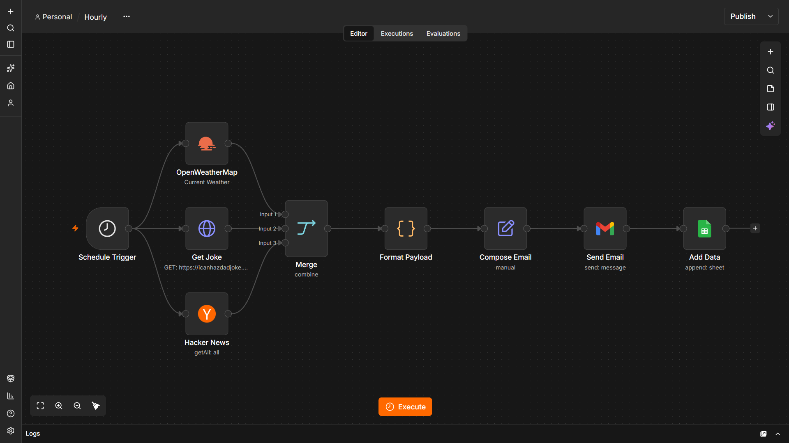

<h1 align="center">
  <b>⏳</b>
     
  <b>Hourly</b>
</h1>

  <a href="https://community.n8n.io/t/hourly-n8n/305271"><b>Hourly</b></a> is an automated email digest system built with <a href="https://n8n.io"><b>n8n</b></a> that automatically compiles and delivers personalized hourly updates straight to your inbox. Stay informed with real-time weather, humor, and top industry news - all in one beautifully formatted email.

  
  

---

## ✳️ _Features_

| FEATUREs | DESCRIPTION | TECHNOLOGY |
| :---: | :---: | :---: |
| **Real-time Weather Updates** | Current conditions, temperature, humidity, and more | **_OpenWeatherMap API_** |
| **Hourly Humor** | A fresh random joke to brighten your hour | **_icanhazdadjoke API_** |
| **Top Industry News** | Top 5 Hacker News headlines with author details | **_Hacker News API_** |
| **Automated Email Delivery** | Sends a beautifully formatted HTML email every hour | **_Gmail API_** |
| **Activity Logging** | Tracks all digest activities with timestamps | **_Google Sheets_** |

---

## ✳️ _Workflow Overview_

Here is a visual overview of the n8n workflow:

---

## ✳️ _Components_

| # | COMPONENTs | DESCRIPTION | NODEs |
| :---: | :---: | :---: | :---: |
| 1️⃣ | **Schedule Trigger** | Runs every hour automatically | **_n8n Schedule Trigger_** |
| 2️⃣ | **OpenWeatherMap** | Fetches current weather data for your location | **_OpenWeatherMap API_** |
| 3️⃣ | **Get Joke** | Retrieves a random dad joke via HTTP request | **_icanhazdadjoke API_** |
| 4️⃣ | **Hacker News** | Fetches top 5 trending tech articles | **_Hacker News API_** |
| 5️⃣ | **Merge** | Combines data streams from weather, joke, and news | **_n8n Merge Node_** |
| 6️⃣ | **Format Payload** | Processes and structures all fetched data | **_JavaScript Code_** |
| 7️⃣ | **Compose Email** | Formats all data into a clean HTML email template | **_n8n Set Node_** |
| 8️⃣ | **Send Email** | Delivers the digest via Gmail | **_Gmail API_** |
| 9️⃣ | **Add Data** | Logs the activity to Google Sheets | **_Google Sheets API_** |

---

  Made with ⏳ by <a href="https://hirishi.in">Saptarshi Roy</a>

